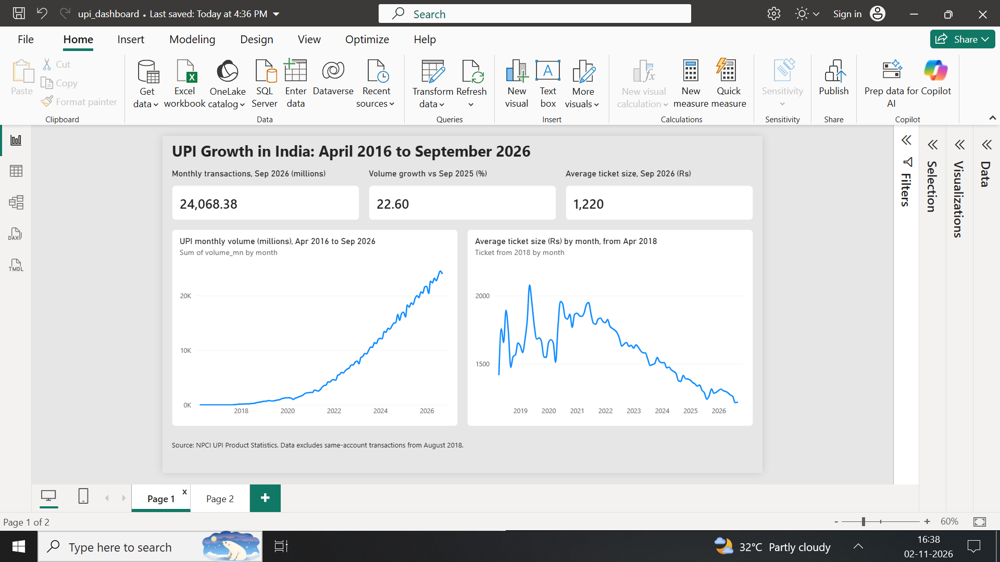
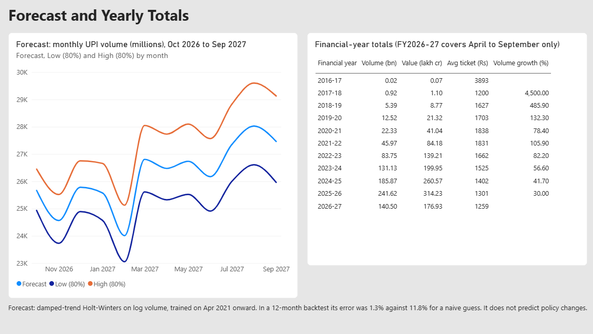

# UPI Growth Analysis (April 2016 to September 2026)

UPI volume grew from 0.02 bn to 241.6 bn transactions a year. Percentage growth slowed from 106% (FY22) to 30% (FY26), but UPI still added about 56 bn transactions in FY26, more than in any earlier year. The average payment fell from a FY21 peak of Rs 1,838 (after the launch year) to Rs 1,301.

## Business question
How fast has UPI grown in India, is growth slowing, and how has the average
transaction size changed?

**Who this is for:** a bank, payments company or fintech team planning capacity
and product focus for UPI.

## Key findings
1. **Scale:** UPI went from 0.02 bn transactions in FY2016-17 to 241.62 bn in
   FY2025-26 (Rs 314.23 lakh crore). September 2026 had 24,068 million transactions.
2. **Percentage growth is slowing every year.** Yearly volume growth fell from
   105.8% in FY2021-22 to 82.2%, 56.6%, 41.7% and 30.0% in FY2025-26.
3. **In absolute terms, UPI still adds more transactions each year.** Yearly
   additions were +37.8 bn in FY2022-23, +47.4 bn in FY2023-24, +54.7 bn in
   FY2024-25 and +55.8 bn in FY2025-26. The percentage slowdown comes mostly
   from the larger base, although the pace of additions is also flattening
   (+54.7 bn to +55.8 bn in the last year).
4. **Still growing about 23% a year.** April to September 2026 volume was
   140.5 bn against 114.1 bn a year earlier (+23.2%), and value grew 19.6%.
   Some press reports give this half-year as about 145 bn (+27%). Summing
   NPCI's monthly figures gives 140.5 bn, and value matches the press figure
   (about Rs 177 lakh crore).
5. **The average ticket is falling.** After the launch year it peaked at Rs 1,838 in FY2020-21 and
   was Rs 1,301 in FY2025-26. September 2026 was Rs 1,220. This is consistent
   with more small payments, but monthly totals cannot show which payment sizes
   are growing, so this is a hypothesis, not a finding.
6. **Seasonality is weak.** Growth, not the calendar, drives the series. Using
   average daily volume against neighbouring months (calendar years 2021 to
   2025, five observations per month), October has the highest average index
   (102.2, about 2% above its neighbours). March, April and December sit about
   1% above, and December and April were at or above 100 in all five years.
   January has the lowest average index (97.7). With only five observations per
   month, treat these as indications.
7. **Forecast:** a baseline model projects about 314.6 bn transactions for
   October 2026 to September 2027, about 17% above the last 12 months.
8. **Forecast spot check:** after the model was built, NPCI reported about
   25,470 million transactions for October 2026 ([Inc42 report](https://inc42.com/buzz/upi-transactions-rise-5-8-mom-to-record-25-47-bn-in-october/);
   NPCI's monthly UPI product statistics are the primary source).
   This is inside the forecast range of 24,936 to 26,448 million (point forecast
   25,666, which is 0.8% above the reported figure). October 2026 is not in the
   dataset used for the model, and one data
   point is a spot check, not proof that the forecast is reliable.

## What this means
- **Plan on absolute growth, not percentage growth.** If yearly additions keep
  rising (finding 3), capacity and monitoring needs still rise even as the percentage falls.
- **Investigate payment mix next.** A falling average ticket (finding 5) should
  be tested with NPCI's merchant-category and P2P/P2M tables, which this project
  did not use.
- **Use the forecast as a baseline only.** Refresh it monthly and compare it with
  NPCI's reported figures (finding 8).

## Dashboard

Power BI file: `power bi/upi_dashboard.pbix`
PDF export of the dashboard: [`dashboard.pdf`](dashboard.pdf)

## How to run
Requires Python 3 and the packages in `requirements.txt`. SQLite is included with Python.
1. Install the packages: `pip install -r requirements.txt`
2. Clean the data: `python combine_upi.py`
3. Run a SQL query: `python run_sql.py sql/01_growth.sql` (repeat for the other files in `sql/`)
4. Run the forecast: `python forecast_upi.py`
5. Yearly additions: `python check_additions.py`
6. Forecast checks (rolling backtest, start-date sensitivity, 80% range coverage):
   `python rolling_backtest.py` (add `--model reference` for the independent scipy version)

## Data
- Source: NPCI, UPI Product Statistics (monthly), npci.org.in
- Coverage: April 2016 to September 2026 (126 months). FY2026-27 covers
  April to September only.
- Columns: banks live on UPI, volume (millions of transactions), value (Rs crore)
- Average ticket size (Rs) = value in crore x 10 / volume in million. Values are
  nominal rupees, not adjusted for inflation.
- NPCI note: data excludes transactions with debit and credit to the same
  account from August 2018 onward.
- Volume is zero for April to June 2016 because UPI had only just launched.

## What is in this repo
- `data_raw/`: the 11 Excel files downloaded from NPCI, one per financial year
- `data_clean/upi_monthly_clean.csv`: combined, cleaned monthly table
- `combine_upi.py`: combines and cleans the raw files
- `sql/` and `run_sql.py`: SQL queries (month-on-month and year-on-year growth,
  seasonality, yearly totals, half-year comparison) run on SQLite
- `check_additions.py`: yearly volume, percentage growth and absolute additions
- `outputs/`: query results, `forecast.csv` and the forecast chart
- `forecast_upi.py`: 12-month forecast with a backtest
- `rolling_backtest.py`: rolling-origin backtest, start-date sensitivity and 80% range
  coverage check (results saved in `outputs/rolling_backtest_*.txt`)
- `dashboard.pdf`: PDF export of the two dashboard pages
- `requirements.txt`: Python packages

## Method
- SQL window functions (LAG) for growth rates. Seasonality uses average daily
  volume so 28, 30 and 31 day months are comparable.
- Forecast: damped-trend Holt-Winters on log volume, trained on April 2021
  onward. April 2021 gave the lowest backtest error of the four start dates tested
  (see the robustness checks below).
- Backtest: the model was trained on April 2021 to September 2025 and asked to
  forecast the 12 months October 2025 to September 2026, which were hidden.
  Error is the average absolute percentage error on monthly volume. The model's
  average error was 1.3%. A naive baseline that repeats September 2025 for all
  12 months had an average error of 11.8%. A stronger baseline (same month last
  year, scaled by last year's growth) had 8.2%.
- Robustness checks (`rolling_backtest.py`, results in
  `outputs/rolling_backtest_statsmodels.txt`): training from April 2019, 2020, 2021 and
  2022 gave 12-month backtest errors of 6.7%, 4.0%, 1.3% and 2.4%. Across nine forecast
  origins (September 2023 to September 2025, each forecasting 12 months), the average
  error was 2.3%, against 13.8% for the naive baseline and 9.4% for the seasonal-growth
  baseline. Error by origin ranged from 3.7% to 1.3% and fell as the training history
  grew from 30 to 54 months. The 80% range contained the actual value in every case
  (target: 80%), so it looks conservative. A separate scipy implementation of the model
  (`--model reference`, saved in `outputs/rolling_backtest_reference.txt`) is a
  cross-check only and was less accurate than the statsmodels model.

## Limitations
- Early-year growth rates (for example about 5,000% in FY2017-18) come from a tiny
  starting base.
- FY2026-27 covers April to September only, so its yearly growth figure is
  not comparable with full years.
- The forecast is a statistical baseline. It does not predict policy changes.
- The headline 1.3% backtest error is the best of nine rolling origins (average 2.3%,
  range 1.3% to 3.7%), so a typical 12-month forecast should be expected to be off by
  roughly 2%, not 1.3%.
- The 80% range contained every actual value in the rolling checks, so it is probably
  wider than needed. With only nine overlapping origins this is an indication, not a
  precise coverage estimate.
- Only monthly totals were used. Bank-wise, app-wise and merchant-category data
  were not analysed, so claims about which payment types are growing cannot be
  tested here.
- Monthly totals hide shocks to individual apps. The RBI action on Paytm Payments Bank
  (31 January 2024) left no visible dent in the totals: average daily volume rose about
  6% from January to February 2024. Measuring an event like this needs app-wise data.
- Average ticket is in nominal rupees.
