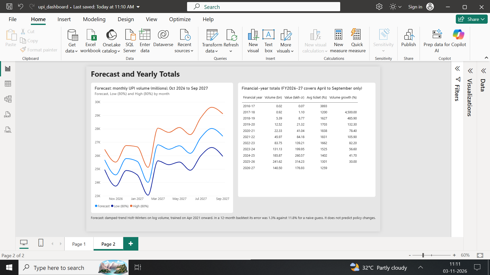

# UPI Growth Analysis (April 2016 to September 2026)

UPI volume grew from 0.02 bn to 241.6 bn transactions a year, but growth slowed from 106% to 30% while the average payment shrank from Rs 1,838 to Rs 1,301.

## Business question
How fast has UPI grown in India, is growth slowing, and how has the average
transaction size changed?

## Key findings
1. **Scale:** UPI went from 0.02 bn transactions in FY2016-17 to 241.62 bn in
   FY2025-26 (Rs 314.23 lakh crore). September 2026 had 24,068 million transactions.
2. **Growth is slowing every year.** Yearly volume growth fell from 105.9% in
   FY2021-22 to 82.2%, 56.6%, 41.7% and 30.0% in FY2025-26.
3. **Still growing about 23% a year.** April to September 2026 volume was
   140.5 bn against 114.1 bn a year earlier (+23.2%), and value grew 19.6%.
4. **The average ticket is falling.** It peaked at Rs 1,838 in FY2020-21 and
   was Rs 1,301 in FY2025-26. September 2026 was Rs 1,220. Small payments are
   growing faster than large ones.
5. **Seasonality is weak.** Growth, not the calendar, drives the series. October
   is the only consistent festive peak (about 2% above its neighbouring months);
   January is the weakest month.
6. **Forecast:** a baseline model projects about 314.6 bn transactions for
   October 2026 to September 2027, about 17% above the last 12 months.
7. **Forecast check:** NPCI reported about 25,470 million transactions for October 2026, inside the baseline forecast range of 24,936 to 26,448 million (point forecast 25,666).

## Dashboard
.png>)

Power BI file: `power bi/upi_dashboard.pbix`

## How to run
1. Install the packages: `pip install pandas openpyxl statsmodels matplotlib`
2. Clean the data: `python combine_upi.py`
3. Run a SQL query: `python run_sql.py sql\01_growth.sql` (repeat for the other files in `sql/`)
4. Run the forecast: `python forecast_upi.py`

## Data
- Source: NPCI, UPI Product Statistics (monthly), npci.org.in
- Coverage: April 2016 to September 2026 (126 months)
- Columns: banks live on UPI, volume (millions of transactions), value (Rs crore)
- Average ticket size (Rs) = value in crore x 10 / volume in million
- NPCI note: data excludes transactions with debit and credit to the same
  account from August 2018 onward.
- Volume is zero for April to June 2016 because UPI had only just launched.

## What is in this repo
- `data_raw/`: the 11 Excel files downloaded from NPCI, one per financial year
- `data_clean/upi_monthly_clean.csv`: combined, cleaned monthly table
- `combine_upi.py`: combines and cleans the raw files
- `sql/` and `run_sql.py`: SQL queries (month-on-month and year-on-year growth,
  seasonality, yearly totals, half-year comparison) run on SQLite
- `outputs/`: query results, `forecast.csv` and the forecast chart
- `forecast_upi.py`: 12-month forecast with a backtest

## Method
- SQL window functions (LAG) for growth rates. Seasonality uses average daily
  volume so 28, 30 and 31 day months are comparable.
- Forecast: damped-trend Holt-Winters on log volume, trained on April 2021
  onward. In a 12-month backtest its average error was 1.3%, against 11.8% for
  a naive guess.

## Limitations
- Early-year growth rates (for example 4,500% in FY2017-18) come from a tiny
  starting base.
- FY2026-27 covers April to September only, so its yearly growth figure is
  not comparable with full years.
- The forecast is a statistical baseline from one backtest. It does not
  predict policy changes, and its 80% range is probably too narrow.
- Only monthly totals were used. Bank-wise and app-wise data were not analysed.
